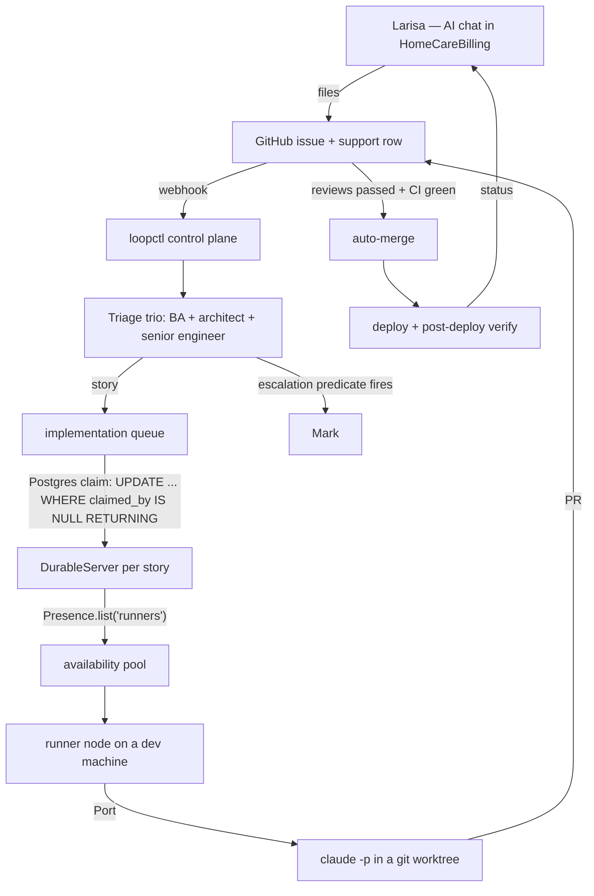

# Agent Delivery Loop — first draft

**Status:** draft for review. Not implemented.
**Date:** 2026-09-12
**Origin:** Chris McCord's "The *Next* agent loop" slide (ElixirConf US 2026) plus Mark's
additions. The slide itself is a six-stage cycle — Build, Test, Benchmark, Release, Monitor,
Fix, with "Prod is the artifact" in the middle — and carries no issue queue, claiming or
dispatch. Everything in this document about detection, triage and dispatch is our design, not
his.

---

## 1. What this is for

Larisa reports a problem through the AI chat already running inside HomeCareBilling. That chat
already files a GitHub issue and a support row in our database. Today the work then waits for
Mark. This loop closes the gap: the issue is triaged by agents, becomes a story, is implemented
on an available dev machine, reviewed, and merged when the reviews and the pipeline both pass.

Mark is involved only when the request seriously contradicts the app as it exists, or demands a
drastic change. Otherwise, never.

**Non-goal:** replacing Mark's judgement on product direction. The loop implements what is
asked; it does not decide what should be asked for.

## 2. Three planes

| plane | where it runs | what it owns |
|---|---|---|
| **Control** | loopctl on Fly | issues, triage, stories, claims, dispatch records, machine registry, audit |
| **Runner** | a Phoenix node on each dev machine | local resources, worktrees, session lifecycle, liveness |
| **Session** | a `claude -p` OS process in a worktree | the actual code change |

### Transport between control and runner: an authenticated Phoenix Channel, NOT a BEAM cluster

An earlier revision of this document assumed the runners would cluster with loopctl over
distributed Erlang so that `Group` could hold the machine pool. **That was wrong and is
reversed here.** Clustering would put a dev laptop inside the production BEAM cluster, where
`:erpc` reaches everything and a compromised machine is a compromised control plane — against a
multi-tenant app holding customer data, and reachable from home networks behind NAT that would
need Fly WireGuard to join at all.

The runner is a **client**: it connects outbound to loopctl over an authenticated Phoenix
Channel and speaks a versioned message contract. Consequences:

- **Presence replaces `Group` for the availability pool.** `Phoenix.Presence` on the runner
  channel gives exactly the property we wanted — registration dies with the socket, so a
  runner that crashes, reboots or loses its network leaves the pool with no TTL sweeper and no
  stale row — without any clustering. `Group` stays a good library; it is simply solving a
  problem we no longer have.
- The blast radius of a compromised dev machine is one channel token, revocable centrally.
- `SocketDist` is irrelevant here (it separates lanes *within* a BEAM cluster). If trace
  streaming ever competes with control traffic, the answer is a second channel topic.
- `reverse_it` stays relevant only if Larisa is ever given a live preview of a branch, which
  section 9 says she is not.

The single most important fact in this design: **a Claude Code session is an OS process with a
unix socket, not a BEAM process.** It cannot be a `pid` in the cluster, cannot be supervised by
OTP directly, and cannot be linked to. The runner node owns it through a Port and observes it
through its on-disk registry (`~/.claude/sessions/<pid>.json`) and transcript
(`~/.claude/projects/<slug>/<sessionId>.jsonl`). Every piece of OTP machinery here wraps the
session; none of it *is* the session.



In words: Larisa's chat files a GitHub issue and a support row. A GitHub **webhook** — not a
poller — reaches the loopctl **control plane**, which runs the **triage trio**. The trio either
emits a **story** into the implementation queue, or fires the **escalation predicate** and stops
at Mark. A story is claimed out of the queue by a **Postgres transaction**, which starts a
**DurableServer** for that story. The DurableServer picks a **runner node** out of the
availability pool published by **Phoenix Presence**, and the runner starts a **`claude -p`
session** in a git worktree through a Port. The session opens a **PR**. When reviews pass and CI
is green the PR **auto-merges**, deploys, and is verified — and only then does the outcome reach
Larisa.

## 3. Stage machine

One `DurableServer` per story, keyed `story/<id>`, state persisted to object storage (Tigris) or
EKV. It survives a loopctl deploy, a runner crash and a machine reboot — which is the whole
reason it is a DurableServer and not a GenServer or an Oban job.

```
detected -> triaged -> queued -> claimed -> worktree -> implementing
         -> reviewing -> pr_open -> ci -> merged -> deployed -> verified -> done
                                                 \-> escalated (terminal until Mark acts)
                                                 \-> failed (terminal, with reason)
```

Every transition is an append to the story's audit chain. `escalated` and `failed` are terminal
for the loop and are the only two states that page a human.

## 4. The triage trio

Three agents that already exist in `claude-config`, dispatched in ONE message so they run
concurrently, each reading the issue, the support row, the repo and the KB:

| agent | question it answers |
|---|---|
| `business-analyst` | What is actually being asked? Acceptance criteria, test cases, what "done" means. |
| `elixir-systems-architect` | Does this fit the current architecture? What does it touch? |
| senior engineer (the `/code-review` senior lens) | Is this implementable as scoped, and what breaks? |

They **create** the story and **quickly review** it — one pass, not a loop. Output is a single
story document plus a structured verdict:

```json
{
  "verdict": "story" | "escalate" | "reject",
  "story": { "title": "...", "acceptance_criteria": [...], "test_cases": [...],
             "touches": ["lib/...", "priv/repo/migrations/..."] },
  "escalation_reasons": [...],
  "contradicts": [{"kind": "story"|"kb"|"code", "ref": "...", "why": "..."}],
  "confidence": 0.0
}
```

`reject` exists for the genuinely non-actionable — a duplicate, or a request that is already
implemented. It replies to Larisa in the chat and closes the issue, and it does not reach Mark.

**Bound it: one triage pass.** A trio that disagrees does not iterate — disagreement is itself an
escalation signal (see below). This is the same rule as the review-round ceiling, for the same
reason: each extra pass has fresh material to find problems in and cannot converge by
construction.

## 5. The escalation predicate

This is the highest-risk component in the design. With the trio clearing triage and the merge
gated only on reviews plus pipeline, this predicate is the only thing between a misread bug
report and a merged change to Medicaid billing. It is therefore **mechanical first, judgement
second**: any one of the hard triggers escalates regardless of what the agents think, and the
agents can only ever add escalations, never remove one.

**Hard triggers — path and content based, no model judgement:**

- a file under `priv/repo/migrations/` is touched
- anything under an auth, session, permission or credential path
- a change to billing-code mapping, rate tables, or claim generation (the 837P path)
- a change to PHI handling, retention, or export
- a new external egress destination, or a new dependency in `mix.exs`
- a change to a payer-facing artifact format
- the diff exceeds **12 files or 1,000 changed lines** (see the calibration below)
- `mix.lock` changes for anything other than a patch bump

**Soft triggers — the agents' own signals:**

- the trio's verdicts disagree with each other
- `contradicts` is non-empty against an existing story, KB decision, or documented behaviour
- the request would remove or invert behaviour a previous story deliberately added
- Larisa's request implies a workflow change rather than a defect fix

### Calibrating the diff-size trigger against real history

Measured on `home_care_billing`, 80 first-parent commits, 2026-09-12:

| | median | p75 | p90 | max |
|---|---|---|---|---|
| files changed | 8 | 17 | 37 | 183 |
| lines changed | 722 | 1,913 | 4,596 | 38,698 |

The draft's placeholder of 15 files / 400 lines would have escalated **more than half of all
changes** on the line count alone, since the median change is already 722 lines — precisely the
"constantly needing Mark" outcome the design is meant to avoid. **12 files / 1,000 lines** sits
above the median and below p75: an ordinary change passes, a bundle-sized one escalates.

One honest limit on that number: these are first-parent commits on master, i.e. merges of
staging PRs that bundle several changes each, so the distribution is an upper bound rather than
the distribution of single-issue fixes. A Larisa-sized bug fix sits well below the median, which
means the trigger has more headroom than the table suggests. Re-measure against the first fifty
loop-authored PRs and tighten it then — with real data instead of a guess in either direction.

**On `confidence`: do not gate on it.** Mark's instruction was not to set it prohibitively high;
the stronger answer is that a self-reported scalar is the weakest signal on the list and should
not be a trigger at all. Three independently-prompted agents *disagreeing* is a comparison
between separate judgements and is a far better escalation signal than any one of them rating
itself. So `confidence` is recorded on the story and used for ranking and post-hoc analysis, and
**disagreement is what escalates**.

If a numeric gate is wanted later, the way to earn it is to log for a fortnight what a
threshold of 0.5 *would* have escalated without acting on it, then set the number from that
record. Picking one now would be inventing a constant and then trusting it.

Everything else proceeds without Mark. **The predicate is a pure function over the issue, the
trio's output and the proposed touch list, and it must have its own test suite with recorded
real cases** — otherwise it degrades silently into whatever the model felt like that day.

The predicate is falsifiable by construction: run it against a mutated input that should escalate
and assert it does (`bin/mutate.sh` is the existing harness for exactly this).

## 6. Claiming: Postgres, not the registry

A story is claimed by a single SQL statement in loopctl's existing database:

```sql
UPDATE stories
   SET claimed_by = $1, claimed_at = now(), state = 'claimed'
 WHERE id = $2 AND claimed_by IS NULL
RETURNING id;
```

Zero rows means someone else won. This is mutual exclusion; a convergent registry is not.

**Do not use `Group` for the claim.** Its README leads with "Eventually Consistent": during a
partition two nodes can hold the same unique key until `resolve_registry_conflict` ranks the
claims, picks a winner and terminates the loser. That is correct behaviour for presence and
wrong for a work claim.

This also fixes a defect the fleet already has: today every session authenticates as one
`agent_id`, and `channel_claim` is idempotent for the owning agent, so a second session claiming
an already-claimed ref gets the existing claim back as though it had won. Two sessions have
already built the same issue in parallel because of it.

## 7. The machine pool

`Phoenix.Presence` on the runner channel. On join the runner tracks itself:

```elixir
Presence.track(socket, "runners", node_name, %{
  cores: System.schedulers_online(),
  memory_mb: ...,
  repos: ["home_care_billing", "loopctl", "claude-config"],
  max_sessions: 2,
  in_flight: 0,
  draining: false
})
```

Leaving the pool deliberately is `draining: true`, then leaving the channel once in-flight
sessions finish. Leaving it accidentally is the socket closing, which Presence already handles.

**Enrolled machines, decided 2026-09-12: minis, mac-mini, blockit.** Three genuine dev boxes.
Explicitly not enrolled:

- **beelink** — dedicated GitHub Actions CI host. Mark may add it later, but not now; it
  currently runs loopctl's `self-hosted` CI jobs and giving it dev work would contend with the
  gate it already serves.
- **xps13** — 4 threads and 8 GB of soldered RAM. Too weak for a build; would be the slowest
  path in any placement decision that picked it.
- **nuc** — not a dev machine.

Placement: prefer a runner that already has the repo cloned with a warm `_build`, then most free
capacity, then lowest `in_flight`. `durable_server`'s capacity-aware and sticky placement
implements this natively on the control-plane side and should be used rather than
reimplemented — it is placing the *orchestrator* process, and the runner choice rides on its
metadata.

## 8. Sessions must never ask a question

Measured, not assumed (KB `f9e9222c-3451-4a72-821d-bb4bf8688c66`): **a peer message can never
answer a blocking question.** An open `AskUserQuestion` is mid-turn, and an inbound message
queues behind the human. No orchestrator can clear a prompt off a screen. A session that asks
blocks until a person arrives, which defeats the entire loop.

So the loop does not answer questions remotely — it prevents them:

- A `PreToolUse` hook on `AskUserQuestion` runs in every loop session. It sees the full
  `tool_input` and either denies with feedback the model reads as its tool result, or allows it
  with `hookSpecificOutput.additionalContext` injected. `claude-config`'s existing
  `gate-ask-user-question.sh` is the same shape and is the starting point.
- In loop mode the hook's default is **deny with the story's acceptance criteria injected** — the
  answer is almost always already in the story the trio wrote.
- A question the hook genuinely cannot answer becomes an `escalated` transition on the
  DurableServer, not a blocked session. The session is stopped, the worktree preserved, and the
  question surfaces to Mark with its context.

Two related traps from the same finding: `CronCreate` dies with its session and cloud routines
cannot see local sockets, so **the detector must be a daemon, not a scheduled Claude task** — the
runner node and the control plane are those daemons. And "waiting on a workflow" and "waiting on
a human" look identical from a transcript tail, so liveness requires positive evidence — no
writes under that session's `subagents/` directory in N minutes — never merely a quiet log.

## 9. Merge

Per Mark's instruction: merge is gated on passed reviews and the pipeline, and does not wait for
him.

1. Session opens the PR on its first green commit, ready for review, not draft.
2. The review gate runs — `/code-review high #<PR>`, bounded at two rounds for code, three as
   the ceiling. A round-three review still finding material defects is evidence about the story,
   not a reason for round four: that path escalates.
3. All confirmed findings are fixed in the same PR. No deferrals.
4. `bin/wait-for-checks.sh` blocks on required checks. Exit 0 merges; anything else does not.
5. `gh pr merge --squash --delete-branch`.
6. Deploy, then a post-deploy verification step.

**What Larisa sees, decided 2026-09-12: the outcome only.** She is notified in the chat she
filed from when a change is *deployed*, and never of work in progress — no PR link, no branch,
no review status, no "an agent has picked this up". Two reasons this is the right cut and not
just a preference: work-in-progress notifications invite her to intervene in a loop designed to
run without intervention, and a PR that is later abandoned or superseded would surface to her as
a broken promise. The states that reach her are `deployed` (with what changed, in her words not
ours) and `escalated`/`failed` — and those two reach *Mark*, who decides what she is told.

Post-deploy verification must confirm the deploy shipped the right commit. A `workflow_run`
deploy ships the TRIGGERING run's commit, not the commit GitHub attributes the deploy to
(KB `3670a0de-1261-4213-a459-f6336048e025`), so the verification step compares the deployed
release's SHA against the merge commit rather than trusting the Actions UI.

The escalation predicate has already run before any of this, so a PR reaching step 5 is by
construction not touching migrations, auth, billing codes or PHI.

## 10. Observability

Steal Chris Ertel's trace format: **one NDJSON event stream per run, every event carrying a
`parent` field**, so the agent tree is reconstructable afterwards. Our audit logs today are
per-session text with no parent link, which is why attributing a subagent's action needs
`bin/who-did-it.sh` instead of a query.

The runner streams that file back to the control plane over the same channel connection. If
trace volume ever starves control messages, the fix is a **second channel topic** with its own
backpressure, not `SocketDist` — that library separates lanes *within* a BEAM cluster, and per
section 2 there is no cluster here. Do not reach for it before the contention is measured.

## 11. What exists already

Do not rebuild these:

- **loopctl**: `dispatches` (with `revoke_expired_dispatches_worker`), `agents`, `coordination`,
  `capabilities`, `custody`, `audit_chain`, `cluster_readiness`, `health_check`, and the story
  lifecycle with contract/claim/start/report/verify.
- **claude-config**: the delivery loop, the review gate and its round counter, worktree
  workflow, `bin/wait-for-checks.sh`, `bin/delete-merged-branch.sh`, `bin/mutate.sh`,
  `gate-ask-user-question.sh`, `block-subagent-git.sh` and the grant sentinel, the `business-analyst`
  and `elixir-systems-architect` agents, the fleet nudger.
- **HomeCareBilling**: the AI chat that files the GitHub issue and the support row.

Genuinely new: the runner node, the triage trio orchestration, the escalation predicate, the
DurableServer stage machine, and the `Group`-backed machine pool.

## 12. Build order

Each step is independently useful and independently revertable.

1. **One runner node, one machine, one hand-filed story, merging nothing.** Proves Port
   supervision, the NDJSON trace, the liveness signal and the question-suppression hook. No
   cluster, no registry, no triage.
2. **The escalation predicate, with its test suite**, run offline against real past issues from
   the support table. Measure its false-negative rate before it gates anything.
3. **The triage trio**, emitting stories into the queue behind a manual approve.
4. **Postgres claiming plus the DurableServer stage machine.** Now a story survives a restart.
5. **Presence-backed machine pool**, second runner, real placement.
6. **Auto-merge**, last, once steps 2 and 5 have run long enough to have a track record.

## 13. Repo placement — decided: the runner gets its own private repo

The question was whether the runner could live in the loopctl repo. It can, and it should not.
The evidence, read off loopctl on 2026-09-12:

**The blocking reason — one app, one release.** `mix.exs` declares `app: :loopctl`; this is a
single Mix project, not an umbrella. Its `releases/0` builds exactly one release. Runner modules
in that project are compiled into the artifact that ships to Fly, so code whose entire purpose is
to spawn shells, drive git worktrees and exec `claude -p` would be *present in the BEAM* of a
multi-tenant production app holding customer data. Not merely callable — loaded. That is the
wrong direction for a repo that already carries an egress guard and a `mix hex.audit` gate with
individually-justified advisory acknowledgements.

**The compounding reason — dependency surface.** The runner needs process supervision
(MuonTrap or erlexec), filesystem watching and `:os_mon`; loopctl's server needs none of them.
Every one would enter loopctl's `mix.lock` and therefore its supply-chain obligations, its
`hex.audit` surface, and its advisory-acknowledgement list.

**The reason that is NOT a blocker, recorded so nobody re-litigates it.** CI coupling is already
solved in that repo: `ci.yml` deliberately carries no workflow-level `paths:` filter and instead
runs a cheap path-probe job that `test` keys off, so a runner directory could have had its own
path-filtered job. The residual cost — the `[self-hosted, beelink]` jobs cancelling in-flight on
every push to a now-busier repo — is real but secondary.

**What DOES belong in loopctl** is the contract, not the client: the channel message schema, the
registration payload, the stage-machine transitions and the trace event schema. loopctl already
has `api_spec/schemas.ex` and an OpenAPI spec, and already publishes client-side artifacts
(a CLI and an MCP server with an npm publish workflow), so a versioned runner contract follows
existing precedent rather than inventing a pattern.

The runner repo is **private**: it holds fleet topology, machine capabilities and the token
handling for a channel that can cause code to be written and merged.

## 14. Packaging and supervision — decided: `mix release`, built on each machine, no Burrito

The enrolled machines are minis (Linux), mac-mini (macOS) and blockit (macOS) — two platforms,
three machines, and **every one already carries a full asdf Elixir toolchain**. That fact settles
it:

- **`mix release`, built on the target machine.** BEAM releases bundle ERTS and are not portable
  across OS or architecture, so a release has to be produced per platform anyway. Building where
  it runs turns that constraint into a non-issue and needs no cross-compilation.
- **Not Burrito.** Burrito's value is shipping to machines *without* a toolchain. All three of
  ours have one, so it buys nothing and costs a cross-compilation setup.
- **Not `mix run`.** A dev loop for a service supervised across reboots is the wrong shape, and
  it couples the runner's uptime to whatever the shell environment happens to be that day.

Supervision, per platform:

- **Linux (minis): `systemd --user`.** A user unit, not a system one — the runner must run as
  `mkreyman` to reach `~/.claude`, `~/workspace`, the asdf shims and the machine's own SSH and
  GitHub credentials.
- **macOS (mac-mini, blockit): a launchd `LaunchAgent`** in `~/Library/LaunchAgents`, with
  `KeepAlive` and `RunAtLoad`, for the same reason.

Two traps worth writing down before anyone hits them:

- **`ExecStart=.../bin/<app> foreground` does not exist in Elixir Releases.** That is Distillery's
  command; using it produces `ERROR: Unknown command foreground` and a systemd restart loop
  (KB `aaa06643-0b09-4f66-aa11-dcd9ddf16bfa`). Use `start`.
- **Do not copy `DynamicUser=true` from the standard hardened BEAM unit file**
  (KB `097c713d-8a66-416e-bbda-071a0a0bd656`). That directive gives the service an ephemeral
  user with a private tmp and a read-only system, which is correct for a network service and
  fatal here — the runner's entire job is reaching the real user's home, repos and credentials.
  The rest of that unit is worth taking: `PrivateDevices=true`, `ERL_CRASH_DUMP_SECONDS=0` (BEAM
  crash dumps on a machine holding PHI-adjacent checkouts are a disclosure risk), and a
  `WatchdogSec`. Prefer `Type=exec` over `Type=notify` unless the runner is wired to send
  `READY=1`.
- In daemon mode a release writes stdout and stderr to `tmp/log/erlang.log.1` under the release
  root, not to the journal (KB `21752a93-eab7-4806-a38d-c64066359d58`).

Installation rides on the existing `claude-config-sync` path — the fleet already has a
convention for pulling to every machine and regenerating per-machine state, and the runner is
one more thing that pull does.

## 15. Still open

Nothing blocking. The two items previously listed here — the diff-size trigger and the
packaging choice — are decided above, in sections 5 and 14 respectively.
